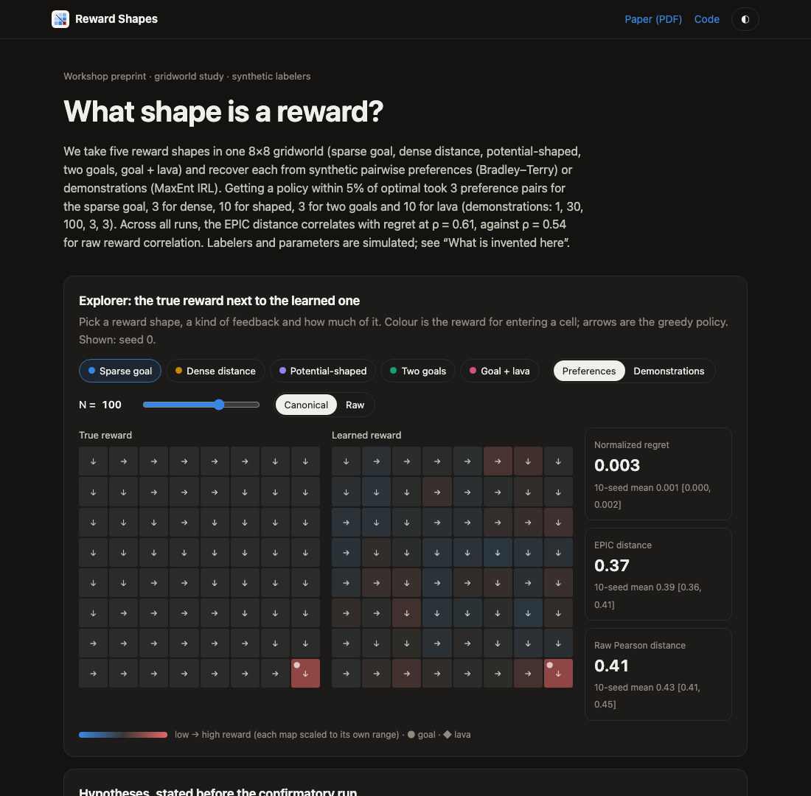
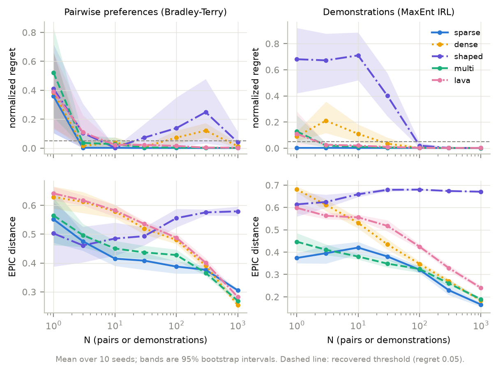
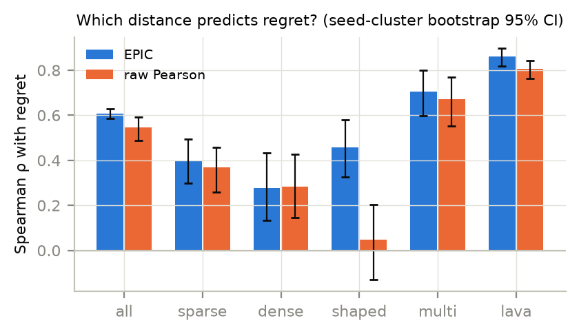

# Reward Shapes

How the shape of a reward (sparse, dense, potential-shaped, two goals, lava) changes how much feedback it takes to recover it, from pairwise preferences or from demonstrations. Also: which distance metric tells you the learned reward is good enough to act on.

**[Website](https://amalmehta.github.io/RewardModeling/)** · **[Paper (PDF)](paper/main.pdf)** · [Setup, run and use](docs/INSTRUCTIONS.md) · [System design](docs/SYSTEM-DESIGN.md) · [What's where](docs/FILE-STRUCTURE.md) · [Manual review checklist](docs/REVIEW-CHECKLIST.md)

Synthetic gridworld with simulated labelers; every invented parameter is listed in the paper and on the site.
