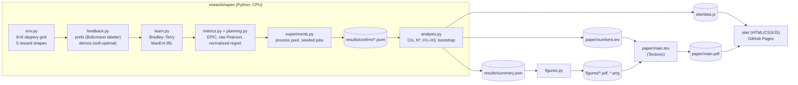

# Reward Shapes: system design

## What it is

A reproducible research pipeline and a static companion website. Python code generates
synthetic feedback in a gridworld, fits reward models, and scores them. The outputs are a JSON
summary, paper figures, LaTeX number macros and the site's data file. The site renders that
data with plain JavaScript; it never computes anything that the paper does not also report.

## Components

| Component | Job |
|---|---|
| `env.py` | Transition tensor `T[s,a,s']` (slip 0.1, walls). The five ground-truth reward tables `R[s,a,s']`, each rescaled to unit std over feasible transitions. |
| `planning.py` | Exact value iteration, exact policy evaluation (a linear solve), soft-optimal policies (infinite-horizon, and finite-horizon time-indexed), normalized regret. |
| `feedback.py` | Vectorised rollouts. Preference pairs share a start state, and the labels come from `σ(β·ΔG)` with the task's discount. Demonstrations come from the finite-horizon soft-optimal policy. |
| `learn.py` | Reward model `R(s,a,s') = u(s) + w(s,a) + v(s')` (384 parameters). Bradley–Terry is convex logistic regression on discounted feature counts. MaxEnt IRL is maximum likelihood through differentiable soft value iteration (PyTorch autograd, L-BFGS). |
| `metrics.py` | Exact EPIC (canonicalisation with uniform D_S, D_A, then Pearson distance over S×A×S'). The raw Pearson baseline on the feasible-transition distribution. Entry maps for plots. |
| `experiments.py` | Builds every job config (main grid, myopic labeler, β ablation, random control, overoptimization, Q-learning shaping study). Runs them in a process pool and writes JSONL. |
| `analysis.py` | 95% t-intervals over seeds, N* (the first N with mean regret ≤ 0.05), Spearman correlations with a seed-cluster bootstrap, and the hypothesis verdicts. Writes the summary, the paper macros and the site data. |
| `figures.py` | Matplotlib figures for the paper, using the validated palette. |
| `run_all.py` | The one command that regenerates everything. |
| `site/` | Static page: the explorer, verdict cards, SVG line charts with crosshair tooltips, tables, light/dark themes. |

## Main flows

1. **Recovery job** (`recovery_job`): config → deterministic RNG from `(shape, feedback, N, seed, β,
   labeler)` → feedback → fit → greedy policy for the learned reward → regret, EPIC and Pearson
   against the truth. For seed 0, it also stores maps and the policy for the site.
2. **Overoptimization job**: fit a proxy from N preferences, rescale it to unit std, then for each λ
   compute the soft-optimal policy, its true normalized return, and its KL from uniform.
3. **Shaping job**: tabular Q-learning on the sparse, dense or shaped reward, with the greedy policy
   scored on the *sparse* task every 10 episodes.
4. **Analysis → outputs**: `summary.json` → figures; `numbers.tex` → paper; `data.js` → site.

## Where data lives

There is no database. All data is synthetic and regenerated from seeds.
- `results/confirm/*.jsonl`: one line per run, committed so that the figures can be rebuilt without
  re-running the experiments.
- `results/summary.json`, `paper/numbers.tex`, `site/data.js`: derived, and regenerated by `run_all`.
- `results/pilot/`: tuning runs, git-ignored (exploration is kept apart from confirmation).

## Key decisions and trade-offs

- **Tabular, exact everything.** Regret comes from a linear solve and EPIC is computed in closed form
  over the full product space, so there is no sampling error in the metrics. All variance comes from
  feedback sampling and is measured across seeds. Trade-off: the results say nothing direct about
  neural reward models.
- **Additive reward model u(s) + w(s,a) + v(s').** It is small (384 parameters), every ground truth
  lies in the class (including potential shaping), and it is defined on all of S×A×S', so EPIC's
  canonicalisation never queries undefined values. Trade-off: it is a well-specified setting, and the
  model is never misspecified except under the myopic-labeler ablation.
- **Labeler and demonstrator use the task's discount γ, and preference pairs share a start.** The
  pilot (seeds 100–104) showed that undiscounted returns identify rewards only up to γ=1 shaping,
  which is not policy-invariant at γ=0.95: shaped-reward regret *rose* with N. Matching the discount
  and sharing starts (as RLHF shares prompts) removes that confound. It is recorded as a pilot
  finding, not hidden.
- **Unit-std rescaling of every true reward.** It makes β mean the same "noise per unit reward"
  across shapes. It is an invented normalisation and is labelled as such.
- **Greedy ties broken uniformly.** A constant reward therefore yields the uniform policy and regret
  exactly 1, so the "no information" baseline is well defined.
- **L-BFGS over Adam.** Bradley–Terry is convex here, so L-BFGS converges deterministically in a few
  dozen iterations and needs no learning-rate tuning.
- **Process pool, one torch thread per worker.** Jobs are independent and small, so parallelism goes
  across processes, not threads.
- **Site: no framework, no build step, data in a `<script>`.** It opens from `file://` and on GitHub
  Pages alike. All interaction re-renders from memory (well under 100 ms), and charts are re-drawn
  only on resize (debounced at 120 ms) or a theme change.

## Testing

`tests/test_core.py` (23 tests) covers: transition rows sum to 1; unit-std rewards; EPIC is zero
between sparse and its shaped version while raw Pearson is not; EPIC is scale/shift invariant,
symmetric, and gives 1 for negation; a constant reward gives EPIC √½ and regret 1; optimal policies
give regret 0; shaping preserves the optimal policy; features reproduce discounted returns; rollouts
follow the dynamics; Bradley–Terry and MaxEnt recover rewards with enough data; soft policies
approach greedy; preference pairs share starts.

## Known limits

- One small gridworld; the 16×16 scaling check is deferred.
- Simulated labelers: Boltzmann-rational, or myopic in one specific way. No human data.
- The ε-greedy trajectory mixture is generous: many compared trajectories are near-optimal, which
  makes preference learning easier than with uninformed sampling.
- Regret saturates: in a gridworld many rewards induce near-optimal policies. EPIC is the more
  discriminating metric at large N, regret at small N.
- EPIC with uniform coverage counts unvisited (s,a) pairs, which no feedback ever constrains, so its
  floor is above 0 even with unlimited data.
